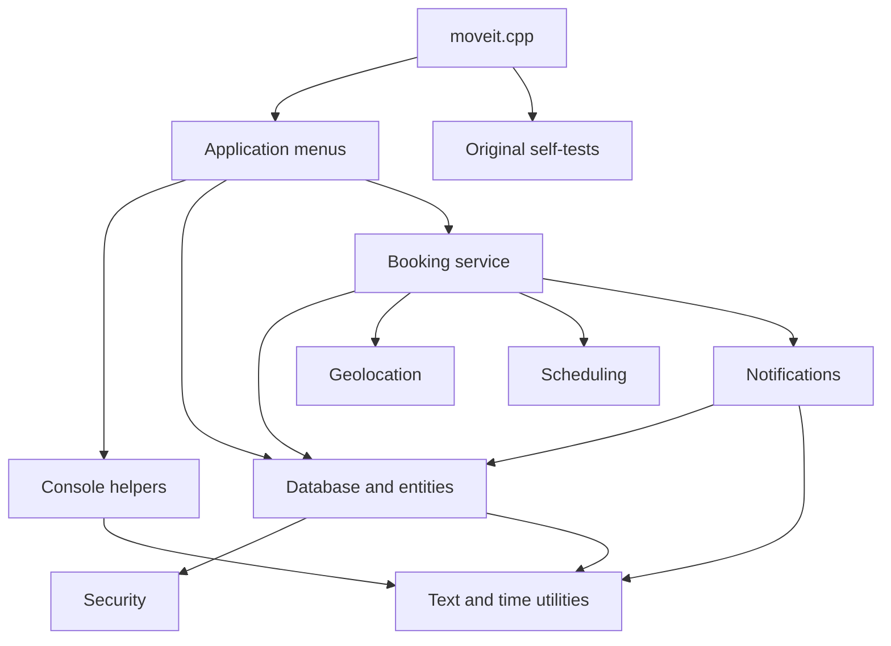
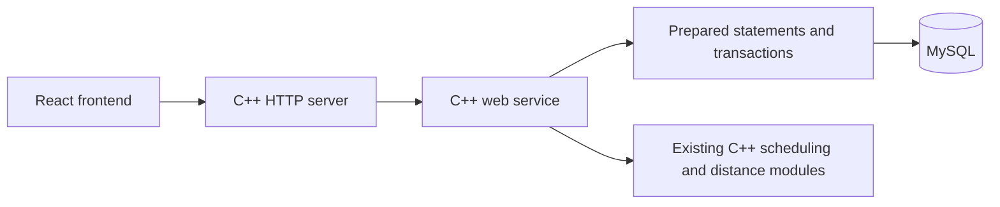

# Move It — modular C++ version

This folder separates the existing `../cpp/moveit.cpp` console application into cooperating C++17 modules. All original project files are retained. The original function bodies, seed data, menus, validation, algorithms and tests are preserved; the changes are file placement, includes, declarations, and the `Class::` qualifiers needed for separate compilation.

The entry point remains **`moveit.cpp`**. The normal build retains the original console `main()` and `--test` option. The `MOVEIT_WEB` build selects a separate C++ HTTP/MySQL entry point in that same file.

## Build and run

From the project root:

```bash
cd cpp-modular
make
make run
```

The console mode requires a C++17 compiler and Make. The web mode described below additionally uses MySQL and OpenSSL; Node.js builds the React frontend. A direct compiler command also works:

```bash
c++ -std=c++17 -O2 -Iinclude moveit.cpp src/*.cpp -o moveit
./moveit
```

Demo accounts use password `Password@123`:

- Admin: `admin@geu.ac.in`
- Student: `rahul.student@geu.ac.in`

In console mode, data is held in memory and reseeded on each launch. Console notification delivery is the existing simulation. In web mode, all application data is stored in MySQL and notifications appear in the browser inbox.

## Modules

| Files | Responsibility |
| --- | --- |
| `moveit.cpp` | Original `main()`; selects the interactive app or self-tests |
| `include/common.hpp` | Original standard includes and shared `string` / `vector` aliases |
| `include/entities.hpp` | Station, user, driver, vehicle, route, trip, booking, notification and conflict types |
| `include/application.hpp`, `src/application.cpp` | Application composition, login/signup, role menus and CRUD commands |
| `include/database.hpp`, `src/database.cpp` | In-memory tables, seed data, booking capacity checks and status transitions |
| `include/security.hpp`, `src/security.cpp` | Existing SHA-256, salts and password hashing |
| `include/geo.hpp`, `src/geo.cpp` | Existing Haversine distance calculation |
| `include/scheduling.hpp`, `src/scheduling.cpp` | FCFS, priority sorting and seat assignment |
| `include/notifications.hpp`, `src/notifications.cpp` | Existing simulated notification messages and log entries |
| `include/booking_service.hpp`, `src/booking_service.cpp` | Demand, nearby alternatives, bookings and batch scheduling |
| `include/console.hpp`, `src/console.cpp` | Input parsing, end-of-input state and console separators |
| `include/utils.hpp`, `src/utils.cpp` | Time formatting and text helpers |
| `include/self_tests.hpp`, `src/self_tests.cpp` | All 15 original self-tests |

`App` owns the database and passes that same database to `Notifier` and `BookingService`. `BookingService` calls the distance and scheduling functions, stores bookings through `Database`, and sends messages through `Notifier`. The database uses the security and text helpers. Console input and formatting support the application menus.



Headers declare each module's interface. Implementations live in the matching `.cpp` files; the `Database::find` template stays in its header because C++ templates must be visible where they are instantiated. The original default argument values are declared in headers and omitted from definitions, as required by C++.

## Verification

```bash
make test
make verify
```

`make test` runs all original self-tests. `make verify` additionally requires Python 3 and the original `../cpp/moveit.cpp`. It checks original-source and method-body hashes, checks unchanged free-function bodies and `main()`, compiles the original into a temporary directory, and compares both executables' test results and scripted console sessions. Displayed wall-clock times are normalized for comparison.

The comparison covers admin/student login, invalid credentials, stations and trips, booking/cancellation, pending requests and batch scheduling, administrative CRUD, notifications, nearby alternatives, signup, and end-of-input handling. `tests/source-map.json` records the source hash and method-body hashes used for these checks.


## C++ web frontend and MySQL mode

The new web mode serves the React frontend directly from C++, with a C++ REST API and persistent MySQL storage. The Express server is not needed for this mode. Everything is contained in this `cpp-modular/` folder; the original `cpp/`, `backend/` and `frontend/` folders are unchanged.

The web application retains the pine/marigold/paper design, login/signup, student/faculty bookings, driver dashboard, admin CRUD, demand board, allocation board, fleet status, fixed departure slots, and in-app notifications.

### Setup

Requirements:

- C++17 compiler and Make.
- MySQL server and C client development files, including `mysql_config`.
- OpenSSL development headers and `libcrypto` for PBKDF2 password hashing, secure random values and signed session tokens.
- Node.js/npm for building the React assets.

From `cpp-modular/`:

```bash
cp .env.example .env
# Edit DB_HOST, DB_USER, DB_PASSWORD and optionally DB_SOCKET_PATH.
# DB_NAME defaults to the separate moveit_cpp database.
make web
make init-sql
cd frontend
npm ci
cd ..
make frontend
make serve
```

Open **http://127.0.0.1:5002**. The C++ process serves both `/api/...` and the built frontend, including browser refreshes on dashboard routes. Run commands from `cpp-modular/` so the `.env`, SQL schema and frontend paths resolve correctly.

`make init-sql` creates only an empty database. It refuses to overwrite any existing tables. The schema has its own seeded accounts and PBKDF2 password hashes; it does not migrate data or credentials from the Express database. `make seed-sql` fills the next seven days without overwriting existing trips. Never point initialization at a database containing other application data.

Available demo accounts (password **`Password@123`**):

| Role | Email |
| --- | --- |
| Admin | `admin@geu.ac.in` |
| Student | `rahul.student@geu.ac.in` |
| Faculty | `sunita.verma@geu.ac.in` |
| Driver | `driver@geu.ac.in` |

Signup creates student/faculty accounts. Administrative and driver accounts are seeded or managed by the institution. A driver can update only their own trip's status. Web passwords use PBKDF2-HMAC-SHA256 with 210,000 iterations and independent random salts. Signed HS256 JWTs expire after seven days, and the server reads the current role from SQL on each authenticated request. Set `JWT_SECRET` to a random value of at least 32 characters to keep sessions valid across restarts; without it the server generates a fresh random key on startup.

### Frontend development

```bash
./scripts/dev.sh
```

This starts the C++ API on port 5002 and Vite on port 3001. Vite forwards `/api` requests to C++. Stop with Ctrl+C. The production build uses relative `/api` URLs and runs entirely on port 5002. `npm ci` is needed only when frontend dependencies are absent; the local workspace may reuse the existing frontend dependency directory.

The console remains available separately with `make run`, and its original behavior is preserved.

### Data and behavior

`sql/schema.sql` supplies the existing station, user, driver, vehicle, route, departure-slot, trip, booking and notification tables, plus relational constraints, capacity triggers and seed data. Slots remain 1:00 PM, 4:00 PM and 6:00 PM in Asia/Kolkata. A later request moves to the next slot; requests after 6:00 PM move to 1:00 PM the next day. Missing schedules return 422, full trips return 409, and demand below `LOW_DEMAND_THRESHOLD` (default 5) creates an in-app notice without cancelling the booking.

Vehicle and driver uniqueness is enforced for each date/slot in MySQL. Maintenance/inactive buses cannot be allocated. Prepared statements bind every user value. Booking transactions lock the trip before claiming seats; SQL triggers enforce capacity and maintain occupancy on confirmation, cancellation, rejection, return to pending, and deletion. Booking details include departure, countdown, bus, driver/contact and route. Notifications, users, bookings and allocations survive server restarts. Web mode sends no WhatsApp messages.

### Web modules

| Location | Purpose |
| --- | --- |
| `moveit.cpp` | Selects the original console or new C++ web entry point at build time |
| `web/src/web_server.cpp` | HTTP server, JSON error responses, React assets and SPA routes |
| `web/src/web_service.cpp` | Authenticated API, SQL-backed bookings, CRUD, driver permissions and admin views |
| `web/src/sql_store.cpp` | MySQL prepared statements, result mapping, transactions, schema initialization and schedule seeding |
| `web/src/web_common.cpp` | Configuration, India-time slot mapping, PBKDF2 and signed tokens |
| `web/include/` | Interfaces between the web modules |
| `web/vendor/` | Pinned cpp-httplib and nlohmann/json headers and their licenses |
| `sql/schema.sql` | Dedicated MySQL schema and demo data |
| `frontend/` | React source, theme, API client and production-build configuration |
| `tests/test_web.py` | Real HTTP/MySQL integration checks in a disposable database |

The SQL web service calls the existing C++ scheduling functions for FCFS/priority allocation and the existing Haversine function for distance requests. The original in-memory `Database` remains the console-mode implementation; `web::Sql` is the persistent web-mode implementation.



### API compatibility

Success responses use `{ "success": true, "data": ... }`; errors use `{ "success": false, "message": ... }`. Authenticated requests send `Authorization: Bearer <token>`.

| Endpoint group | Supported behavior |
| --- | --- |
| `GET /api/health` | Reports the running C++ backend and MySQL connection |
| `/api/auth/login`, `/api/auth/signup`, `/api/auth/me` | Login, commuter signup and profile |
| `/api/stations`, `/api/vehicles`, `/api/drivers`, `/api/routes` | Public reads and admin create/update/delete |
| `/api/trips`, `/api/trips/:id` | Trip reads, admin date/slot allocation and driver status updates |
| `POST /api/trips/:id/schedule-batch` | Existing C++ FCFS/priority allocation for pending bookings |
| `/api/bookings`, `/api/bookings/request`, `/api/bookings/:id` | Own bookings, direct reservations, fixed-slot requests and departure details |
| `PUT /api/bookings/:id/cancel`, `PUT /api/bookings/:id/status` | Owner cancellation and admin status changes |
| `GET /api/notifications`, `PUT /api/notifications/:id/read` | Own inbox and mark-read action |
| `GET /api/slots` | Three fixed departures for authenticated users |
| `GET /api/admin/slots/summary`, `/api/admin/demand/hourly` | Per-destination slot demand and requested-hour buckets |
| `GET /api/admin/bookings`, `/api/admin/fleet` | Filtered booking records and day-specific bus allocations |
| `GET /api/admin/allocations`, `/api/admin/drivers/status` | Slot board, warnings, driver trips and derived status |
| `/api/users`, `/api/users/:id` | Admin listing/deletion and owner profile access/update |

The admin date parameter is `?date=YYYY-MM-DD`; booking filters additionally support `station_id`, `slot_id` and `status`, and hourly demand accepts `station_id`.

### Checks

```bash
make verify
make frontend
make test-web-unit
make test-web
cd frontend && npm run test:ui
```

`make verify` still compares the original console with the console build, including all 15 original tests and 14 scripted sessions. `make test-web-unit` runs 22 checks for datetime/slot mapping, SQL-number conversion, password hashing and signed tokens without a database. `make test-web` requires a running MySQL server, the MySQL CLI, a built frontend and a database user allowed to create/drop test databases. It creates a unique `moveit_cpp_<number>_test` database, tests the C++ process over HTTP, and drops only that database during cleanup. Checks cover permissions, slots, notifications, low-demand boundaries, resource conflicts, concurrent capacity, CRUD and restart persistence.
